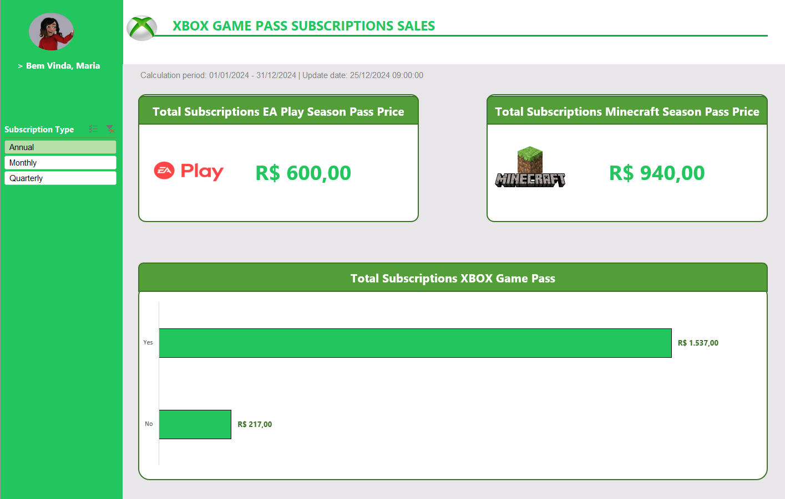

# Xbox Game Pass — Dashboard de Vendas

## Sobre o projeto

Dashboard desenvolvido no Excel para análise de vendas de assinaturas do Xbox Game Pass, com indicadores de faturamento e análises por tipo de plano, renovação automática e serviços adicionais.

---

  

---

## Funcionalidades

- **Análise de faturamento:** total de vendas e faturamento de assinaturas anuais.
- **Renovação automática:** comparação do faturamento entre assinaturas com e sem renovação automática.
- **Análise por plano:** avaliação das assinaturas Core, Standard e Ultimate.
- **Serviços adicionais:** análise das vendas de EA Play Season Pass e Minecraft Season Pass.
- **Base de dados estruturada:** organização das informações de assinantes, planos, períodos de assinatura, preços, cupons e valores totais.

## Dados Utilizados

Base de dados de assinaturas contendo informações sobre clientes, planos contratados, datas de início, periodicidade, renovação automática, serviços adicionais e valores das vendas.

O período de análise apresentado no dashboard é de janeiro a dezembro de 2024.

## Tecnologias e Recursos

- Microsoft Excel
- Tabelas estruturadas
- Tabelas dinâmicas
- Fórmulas e cálculos
- Dashboard para visualização de dados

## Como Utilizar

1. Baixe o arquivo `.xlsx` disponível neste repositório.
2. Abra a planilha no Microsoft Excel.
3. Acesse a aba `Dashboard` para visualizar as análises.

Projeto desenvolvido como atividade prática de aprendizado em Excel.
